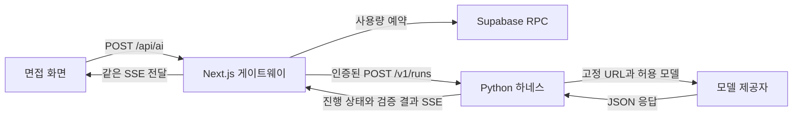

# Python 면접 하네스

브라우저에서 시작한 면접 요청은 Next.js가 수락하고, Python이 한 번의 실행을 끝까지 관리합니다.

## 실행 흐름

1. Next.js는 요청 출처와 본문 크기, 입력 스키마, 모델 선택을 확인합니다. Supabase RPC가 일일 한도를 원자적으로 차감한 뒤에만 실행을 요청합니다. 모델 재시도는 애플리케이션 할당량을 추가로 차감하지 않습니다.
2. Python은 서비스 토큰과 요청 스키마를 독립적으로 검증합니다. 분석, 질문 생성, 답변 평가, 꼬리질문, 종합 평가 중 하나를 실행합니다. 입력과 모델 출력으로 도구나 URL을 추가할 수 없습니다.
3. 질문은 5개 단위로 최대 3묶음을 병렬 처리합니다. 묶음 하나라도 실패하면 나머지 작업을 취소합니다. 전부 통과하면 계획 순서대로 합치고 개수와 ID 중복을 검사합니다.
4. 답변 평가는 다섯 영역의 점수와 근거를 검증합니다. 가장 낮은 점수가 70 미만이면 꼬리질문을 제안하되 질문당 2회로 제한합니다. 마지막 질문에서 꼬리질문 조건을 충족하지 않거나 전체 턴 한도에 도달하면 종합 평가를 제안합니다. 사용자가 제안을 확인할 때 다음 요청을 실행합니다.
5. 결과는 한 번의 `complete` 이벤트로 전달합니다. 오류는 정해진 코드로 변환합니다. 브라우저 연결이 닫히면 Python 스트림 작업과 진행 중인 제공자 요청을 취소합니다.

## 설계 선택

| 판단 | 이유와 비용 |
| --- | --- |
| Python은 실행, Next.js는 웹 요청 수락 | 기존 Supabase 세션·사용량 제한을 재사용하고 AI 실행을 별도 테스트할 수 있습니다. 대신 서비스 간 인증과 두 런타임 배포가 필요합니다. |
| 평가와 분기를 분리 | 동일한 점수와 면접 상태에서 같은 다음 단계가 나옵니다. 분기에 별도 모델 호출을 쓰지 않습니다. |
| 전체 JSON 검증 후 SSE 완료 | 제공자별 부분 응답 차이를 흡수하고 저장 가능한 결과만 UI에 전달합니다. 생성 중에는 상태와 8초 간격의 heartbeat를 표시합니다. |
| 제공자 호출과 재시도 정책을 분리 | HTTP 전송은 시도당 한 번 수행합니다. 런타임은 429, 네트워크, 5xx에 한해 동일 제공자를 한 번 더 시도할 수 있습니다. |
| 실행 상태를 요청 수명에 묶음 | 사용자가 결과를 기다리는 짧은 면접 작업이라 현재 SSE 연결에서 실행과 취소를 관리합니다. 프로세스가 내려가면 진행 중이던 작업은 재개할 수 없습니다. 브라우저의 기존 세션 복원은 별도로 동작합니다. |

전체 실행 예산은 최대 105초입니다. 한 시도는 기본 30초이고 NVIDIA 질문 생성은 75초입니다. 429의 `Retry-After`가 8초를 넘거나 남은 예산을 초과하면 같은 제공자를 재시도하지 않습니다. 대체 설정을 켠 경우에만 최대 3개 제공자를 검토하며 같은 입력이 다른 제공자에게 전송될 수 있습니다. 15문항 요청은 시도 한 번에 최대 3회의 모델 호출을 사용합니다. 재시도와 취소가 이미 제공자에게 도달한 호출의 과금을 취소한다는 보장은 없습니다.

## 코드 읽는 순서

| 파일 | 확인할 내용 |
| --- | --- |
| [app/api/ai/route.ts](../app/api/ai/route.ts) | 웹 요청 수락, Supabase 할당량 차감, SSE 전달 |
| [python_harness/app.py](../python_harness/app.py) | 서비스 토큰 검증, 본문 제한, 모델 목록, 스트림 수명 |
| [python_harness/runtime.py](../python_harness/runtime.py) | 실행 예산, 재시도, 배치, 분기 |
| [python_harness/contracts.py](../python_harness/contracts.py) | Pydantic 요청·응답 모델, 평가 영역 중복 검사 |
| [python_harness/providers.py](../python_harness/providers.py) | 고정 URL, 제공자별 요청 구성, 실패 분류 |
| [python_harness/tests/test_harness.py](../python_harness/tests/test_harness.py) | 합성 응답으로 실패·취소·권한·검증 재현 |

## 로그로 요청 출처 찾기

1. Groq 콘솔의 요청 ID를 Python 로그의 `provider_call upstream=req_…`에서 찾습니다. Groq가 Chat Completions 응답에 제공한 `x_groq.id`를 사용하며, 가능한 경우 응답 헤더의 요청 ID를 사용합니다.
2. 같은 줄의 `run`으로 `harness_event`를 조회하면 도구, 모델, 시도 순서와 실패 코드를 확인할 수 있습니다.
3. Vercel에서 동일한 ID의 `ai_gateway`를 찾으면 `POST /api/ai` 실행과 연결됩니다. 이 경로는 `/interview`와 `/interview/[id]`가 공유합니다.

로그는 실행 ID, 단계, 모델, HTTP 상태 등 실행 메타데이터만 기록합니다. 이전 배포의 호출에 이 ID가 소급 적용되지는 않습니다. 제공자가 요청 ID를 반환하기 전에 연결이 끊기면 내부 실행 ID로 추적합니다. [Groq API 레퍼런스](https://console.groq.com/docs/api-reference)

## 검증 범위

`python -m unittest discover -s python_harness/tests -v`는 외부 API 키 없이 HTTP 모의 응답을 사용합니다. 분기 경계값, 비인가 요청, 잘못된 모델 및 출력, 429 재시도, 대체 허용 여부, 배치 실패와 연결 종료를 재현합니다. [Next.js 게이트웨이 테스트](../tests/interview-python-gateway.test.ts)는 동일 출처와 할당량 검사를 통과한 뒤에만 Python 실행을 요청하는지 확인합니다.

스키마 검증은 응답 형태와 도메인 불변식을 보장합니다. 면접 점수의 정확도나 질문의 사실성은 별도 평가가 필요합니다. 로컬과 CI 테스트는 실제 제공자 연결과 운영 Supabase 권한을 대신 검증하지 않습니다.
